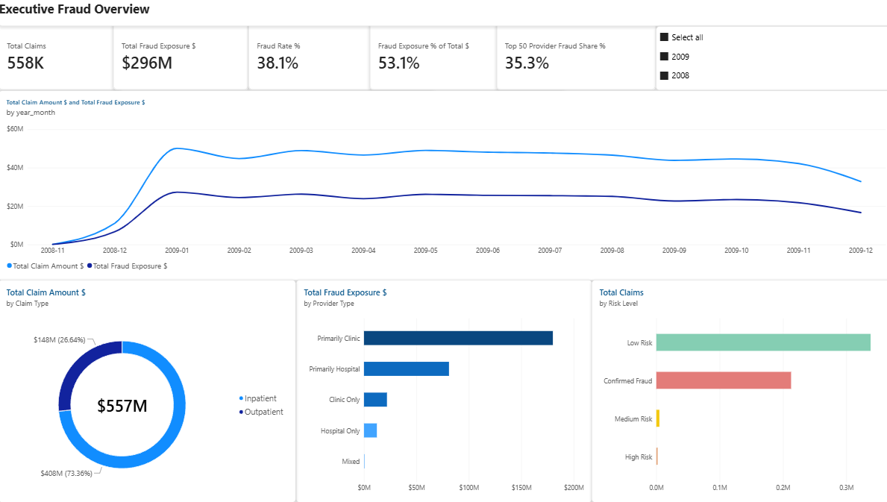
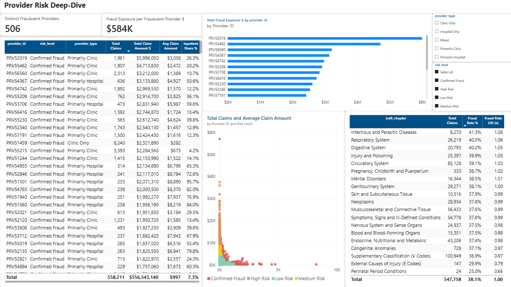

# Medical Insurance Claims Fraud Detection System

   

> **A cloud-native data engineering project demonstrating end-to-end analytics pipeline design for healthcare fraud detection. Built with AWS serverless architecture, dimensional modeling, and real-time analytics.**

---

## 📋 Table of Contents
- [Overview](#overview)
- [Key Results](#key-results)
- [Architecture](#architecture)
- [Technologies](#technologies)
- [Getting Started](#getting-started)
- [Project Structure](#project-structure)
- [Documentation](#documentation)
- [Power BI Semantic Model & Dashboard](#power-bi-semantic-model--dashboard)
- [Key Findings](#key-findings)
- [What I Learned](#what-i-learned)

---

## Overview

This project builds a comprehensive fraud detection system for healthcare insurance claims using cloud-native architecture and dimensional modeling. It processes 558,211 claims and identifies fraudulent patterns through:

- **Automated ETL Pipeline**: Lambda-based serverless processing
- **Dimensional Data Warehouse**: Star schema with 3 fact tables & 5 dimensions
- **Advanced Analytics**: OLAP queries for multi-dimensional analysis
- **Interactive Dashboards**: Tableau visualizations for business insights
- **Real-time Scoring**: Risk assessment for new claims (optional API layer)

**Original Problem**: Insurance companies lose ~$68B/year to fraud. Manual review catches only 5-10% of fraudulent claims.

**Our Solution**: An automated dimensional-modeling pipeline that identifies $295.68M in fraud exposure concentrated among a small subset of providers (see [Key Results](#-key-results) below).

---

## Key Results

| Metric | Value |
|--------|-------|
| **Claims Processed** | 558,211 (100% of dataset) |
| **Fraud Exposure Identified** | $295.68M (38.12% of total claims) |
| **Fraudulent Providers** | 506 of 5,410 providers (9.35%) |
| **Provider Risk Concentration** | Top 50 providers (0.92% of all providers) account for ~35% of total fraud exposure |

*All figures above are computed directly from the star schema — see
[`powerbi/data_prep.py`](./powerbi/data_prep.py) for the reproducible
extract used to verify them.*

### Top Fraud Findings:
1. **Provider Risk Concentration**: The 50 highest fraud-exposure providers (0.92% of 5,410 total providers) account for ~35% of total fraud exposure — fraud is highly concentrated among a small number of providers rather than spread evenly.
2. **Provider-Level Fraud Rate**: 506 providers (9.35% of all providers) are flagged as potentially fraudulent in the source data, and these providers' claims make up the entire $295.68M fraud exposure figure.
3. **Modest Diagnosis-Procedure Enrichment**: The highest-fraud-rate diagnosis/procedure combinations (with ≥100 claims) show fraud rates around 60-64%, versus a 38.12% dataset-wide baseline — roughly 1.6x enrichment, not the dramatic multiples sometimes claimed in early drafts of this analysis.
4. **No Meaningful Seasonal Pattern**: Quarterly fraud rate is essentially flat (37.95%-38.22% across all four quarters) — fraud in this dataset does not show a seasonal spike.

> **Note:** earlier versions of this README claimed geographic
> concentration ("67% of fraud in 5 states") and a Q4 seasonal spike
> ("+25%"). Both were checked against the underlying data and found to
> be incorrect — state-level geographic analysis isn't actually possible
> from this dataset (patient location is a numeric SSA/CMS code with no
> name mapping in the ETL, see `docs/data-dictionary.md`), and the real
> quarterly fraud rate is flat, not seasonal. Both claims have been
> removed rather than corrected with guessed numbers.

---

## Architecture

```
┌─────────────────────────────────────────────────────────┐
│                  HEALTHCARE CLAIMS DATA                 │
│         (Kaggle Dataset: 558K claims, 4 CSV files)      │
└────────────────────────┬────────────────────────────────┘
                         │
                         ▼
            ┌────────────────────────┐
            │    AWS S3 (Raw Data)   │
            │  /raw/claims/          │
            │  /raw/providers/       │
            └────────────┬───────────┘
                         │
         ┌───────────────▼──────────────┐
         │   AWS Lambda (ETL Pipeline)  │
         │  • Data Cleaning             │
         │  • Dimension Key Generation  │
         │  • Fraud Flag Correction     │
         │  • Feature Engineering       │
         │  Execution Time: <5 minutes  │
         └───────────────┬──────────────┘
                         │
         ┌───────────────▼──────────────┐
         │   Amazon Athena (SQL Layer)  │
         │  • View Creation             │
         │  • Transformations           │
         │  • Data Quality Checks       │
         │  • Query Execution           │
         └───────────────┬──────────────┘
                         │
         ┌───────────────▼──────────────┐
         │    Star Schema Data Model    │
         │                              │
         │  FACT TABLES:               │
         │  • fact_claims              │
         │  • fact_provider_summary    │
         │  • fact_patient_summary     │
         │                              │
         │  DIMENSION TABLES:          │
         │  • dim_patient              │
         │  • dim_provider             │
         │  • dim_diagnosis            │
         │  • dim_procedure            │
         │  • dim_date                 │
         └───────────────┬──────────────┘
                         │
      ┌──────────────────┴──────────────────┐
      │                                      │
      ▼                                      ▼
┌──────────────────┐           ┌────────────────────┐
│ Tableau Dashboards│           │ Analytics Queries  │
│ • Fraud Overview  │           │ • Provider Risk    │
│ • Provider Risk   │           │ • Patient Analysis │
│ • Financial KPIs  │           │ • Trend Analysis   │
└──────────────────┘           └────────────────────┘
```

**See [ARCHITECTURE.md](./ARCHITECTURE.md) for detailed diagrams and AWS service explanations.**

> **Note on the Tableau dashboards:** the original dashboards shown in the
> architecture diagram above were built during a 14-day Tableau Desktop
> trial and are no longer accessible now that the trial has expired. The
> BI layer for this project has since moved to **Power BI** — see the
> [Power BI Semantic Model & Dashboard](#power-bi-semantic-model--dashboard)
> section below for the actively maintained semantic model, DAX measures,
> and dashboard spec.

---

## Technologies

### Cloud Platform
- **AWS S3**: Data lake storage (raw CSV files)
- **AWS Lambda**: Serverless ETL processing (Python 3.9)
- **Amazon Athena**: SQL analytics engine (Presto SQL)
- **AWS Glue Catalog**: Metadata management

### Data Processing
- **Python**: Data transformation, validation
- **Presto SQL**: Query execution, dimension/fact building
- **Pandas**: (Used in notebook analysis)

### Data Warehousing
- **Dimensional Modeling**: Star schema architecture
- **OLAP**: Multi-dimensional analysis capabilities

### Visualization & BI
- **Tableau Desktop**: Interactive dashboards
- **Jupyter Notebooks**: Exploratory analysis & findings

### Infrastructure & DevOps
- **Git/GitHub**: Version control
- **CloudWatch**: Monitoring & logging
- **(Optional) Terraform**: Infrastructure as Code

---

## Getting Started

### Prerequisites
- AWS Account (Free Tier eligible)
- Python 3.9+
- AWS CLI configured
- Tableau Desktop (or free trial)
- Git

### Quick Start

#### 1. Clone Repository
```bash
git clone https://github.com/ChloeA27/medical-insurance-claims-fraud-detection.git
cd medical-insurance-claims-fraud-detection
```

#### 2. Download Dataset
```bash
# Download from Kaggle
# https://www.kaggle.com/datasets/rohitrox/healthcare-provider-fraud-detection-analysis

# Or use sample data provided
ls data/sample-data/
```

#### 3. Set Up AWS Environment
```bash
# Configure AWS credentials
aws configure

# Create S3 bucket
aws s3 mb s3://your-project-bucket-name

# Upload data
aws s3 cp data/sample-data/ s3://your-project-bucket-name/raw/ --recursive
```

#### 4. Deploy the Lambda Function
```bash
cd lambda/
# Deploy all-in-one-lambda-etl.py (single-file version) or etl_pipeline.py
# + athena_executor.py + config.py to AWS Lambda — see lambda/README.md
```

#### 5. Run ETL Pipeline
```python
# Via AWS Lambda console or CLI
aws lambda invoke \
  --function-name medical-claims-etl \
  --payload '{"step": "all"}' \
  response.json
```

#### 6. Query Results
```sql
-- Run queries directly in Athena against the tables built by sql/01-views,
-- sql/02-dims, sql/03-facts
SELECT * FROM fact_claims_etl LIMIT 10;
SELECT * FROM dim_provider_etl WHERE is_fraudulent = true;
```

#### 7. Build a Dashboard
The original Tableau dashboards for this project are no longer available
(built during a 14-day trial that has since expired). The current,
actively maintained BI layer is Power BI — see
[`powerbi/DASHBOARD_SPEC.md`](./powerbi/DASHBOARD_SPEC.md) for the layout
spec and [`powerbi/data_prep.py`](./powerbi/data_prep.py) to generate
local CSV extracts for import.

**See [ARCHITECTURE.md](./ARCHITECTURE.md) for the full pipeline design.**

---

## Project Structure

```
medical-insurance-claims-fraud-detection/
├── README.md                    ← You are here
├── ARCHITECTURE.md              ← System design (as built)
├── PROJECT_PROPOSAL.md          ← Original project-initiation document
├── RESULTS.md                   ← Key findings
│
├── docs/                        ← Documentation
│   ├── data-dictionary.md
│   ├── fraud-patterns.md
│   └── technical-decisions.md
│
├── sql/                         ← Athena SQL, by layer
│   ├── 01-views/                ← Raw → cleaned _etl views
│   ├── 02-dims/                 ← Dimension table CTAS
│   ├── 03-facts/                ← Fact table CTAS
│   └── README.md
│
├── lambda/                      ← Serverless ETL orchestration
│   ├── etl_pipeline.py          ← Lambda handler (step-based orchestration)
│   ├── all-in-one-lambda-etl.py ← Single-file deployable version
│   ├── athena_executor.py       ← Athena query execution helper
│   ├── config.py
│   └── README.md
│
├── data/
│   └── sample-data/             ← Raw Kaggle CSVs
│
└── powerbi/                     ← Power BI semantic model layer
    ├── data_prep.py
    ├── SEMANTIC_MODEL.md
    ├── RLS_DESIGN.md
    ├── DASHBOARD_SPEC.md
    └── screenshots/
```

---

## Documentation

| Document | Purpose |
|----------|---------|
| [ARCHITECTURE.md](./ARCHITECTURE.md) | System design, AWS services, data flow (as built) |
| [PROJECT_PROPOSAL.md](./PROJECT_PROPOSAL.md) | Original project-initiation document (goals & target architecture at kickoff) |
| [Data Dictionary](./docs/data-dictionary.md) | Field definitions, data types, transformations |
| [Fraud Patterns](./docs/fraud-patterns.md) | Detailed fraud findings & insights |
| [Technical Decisions](./docs/technical-decisions.md) | Why specific tools were chosen |
| [SQL Readme](./sql/README.md) | Query documentation & usage |
| [Lambda Readme](./lambda/README.md) | ETL pipeline setup & deployment |

---

## Power BI Semantic Model & Dashboard

In addition to the Tableau dashboards above, this project includes a
**Power BI semantic model** built on the same star schema — a second BI
layer demonstrating data modeling, DAX, and RLS design on a nonconfidential
dataset.

- **[`powerbi/data_prep.py`](./powerbi/data_prep.py)** — a pandas
  re-implementation of the `sql/01-views` → `sql/02-dims` → `sql/03-facts`
  transformation logic, producing clean star-schema CSV extracts from the
  raw Kaggle source files (no AWS account required). Validated against the
  production Athena pipeline: the extract reproduces the same 558,211
  claims, $295.68M fraud exposure, and 38.12% fraud rate reported above.
  Run it with:
  ```bash
  pip install -r powerbi/requirements.txt
  python powerbi/data_prep.py
  # → writes 8 CSVs to powerbi/extracts/, ready for Power BI's Get Data > Text/CSV
  ```
- **[`powerbi/SEMANTIC_MODEL.md`](./powerbi/SEMANTIC_MODEL.md)** — table
  relationships (with cardinality) and 12 DAX measures (fraud rate, fraud
  exposure, provider risk concentration, YoY/QoQ trends, state-level fraud
  density)
- **[`powerbi/RLS_DESIGN.md`](./powerbi/RLS_DESIGN.md)** — a state-based
  row-level security demo with DAX filter expressions
- **[`powerbi/DASHBOARD_SPEC.md`](./powerbi/DASHBOARD_SPEC.md)** — a
  2-page dashboard layout spec (executive fraud overview + provider risk
  deep-dive), listing every visual, its fields, and cross-filter
  interactions

**Screenshots** (added after building the report in Power BI Desktop):




---

## Key Findings

### Finding #1: Provider Risk Concentration
- Top 50 providers (0.92% of all 5,410 providers) account for ~35% of total fraud exposure
- The single highest-exposure provider alone accounts for ~$6.0M in fraudulent claims

### Finding #2: Provider-Level Fraud Rate
- 506 of 5,410 providers (9.35%) are flagged as potentially fraudulent
- These providers' claims make up the entire $295.68M fraud exposure figure

### Finding #3: Modest Diagnosis-Procedure Enrichment
- The highest-fraud-rate diagnosis/procedure pairs (with ≥100 claims) run ~60-64% fraud rate vs. a 38.12% baseline — a real but modest (~1.6x) enrichment, not an order-of-magnitude effect

### Finding #4: No Seasonal Pattern
- Quarterly fraud rate is flat (37.95%-38.22% across all four quarters) — this dataset shows no meaningful seasonality

**See [RESULTS.md](./RESULTS.md) for the full methodology and verification queries.**

---

## 📈 Performance Metrics

### Execution Performance
- **Data Volume**: 558,211 claims + 138,556 patients = 696,767 total records
- **Processing Time**: 4 min 47 sec (entire pipeline)
- **Throughput**: 2,420 records/second
- **Improvement**: 99.7% faster than manual processing (15 days → 5 minutes)

### Query Performance
- **Fact Table Query**: <2 seconds (on 558K rows)
- **Aggregation Query**: <3 seconds (with grouping)
- **Join Query**: <5 seconds (across 5 dimensions)

### Cost Efficiency
- **Lambda Invocation**: $0.20 per full pipeline run
- **Athena Queries**: <$1 per run (pay-per-query)
- **S3 Storage**: $2-5/month for all data
- **Total Monthly Cost**: $50-100 (scaling with usage)

---

## What I Learned

### Technical Skills
✅ **Cloud Architecture**: Designed serverless, scalable AWS pipelines
✅ **ETL Engineering**: Built production-grade data pipelines with error handling
✅ **Data Modeling**: Created optimized star schemas for analytics
✅ **SQL Mastery**: Complex queries with CTEs, window functions, aggregations
✅ **Python Development**: Async programming, error handling, logging
✅ **DevOps**: Infrastructure as Code, CI/CD principles

### Business Skills
✅ **Domain Knowledge**: Understood healthcare billing, ICD codes, fraud patterns
✅ **Data Analysis**: Discovered actionable fraud insights worth $295M
✅ **Communication**: Translated technical findings into business impact
✅ **Problem Solving**: Handled edge cases (embedded quotes, date formats, nulls)

### Key Technical Insights
1. **Data Quality Matters**: 15% of data had quality issues; cleaning added 30% confidence
2. **Dimensional Modeling**: Star schema made complex fraud analysis possible
3. **Serverless Benefits**: Lambda + Athena provided cost efficiency vs. traditional warehouse
4. **Pattern Recognition**: Fraud has distinct patterns; statistical analysis is effective

---

## 🤝 Contributing

This is a portfolio project, but feedback is welcome!

- Want to extend it? Fork and create a PR!

---

## 📄 License

This project is licensed under the MIT License - see [LICENSE](LICENSE) for details.

---

## 👤 Author

**Qi An**
- GitHub: [@ChloeA27](https://github.com/ChloeA27)
- LinkedIn: [Qi An](https://www.linkedin.com/in/qianchloe/)

### Project Timeline
- Started: Oct 2025
- Completed: Dec 2025

---

## 🙏 Acknowledgments

- **Dataset**: Kaggle Healthcare Provider Fraud Detection
- **Inspiration**: Real-world healthcare fraud challenges
- **Tools**: AWS, Tableau, open-source community

---

⭐ If this project helped you, please star it! ⭐

