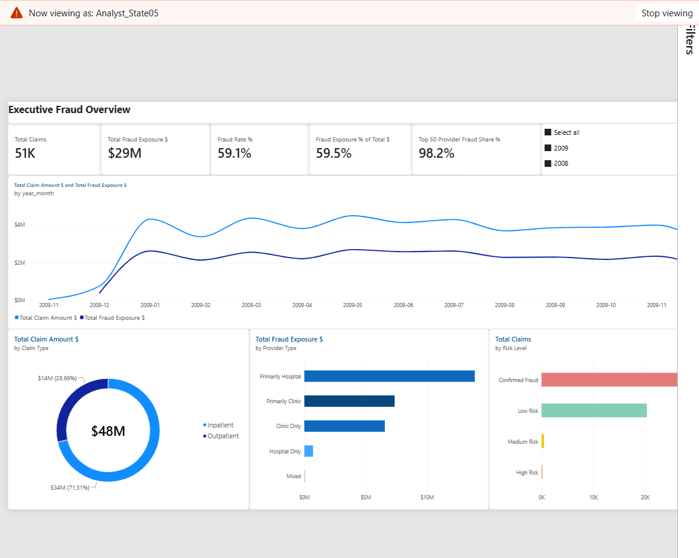
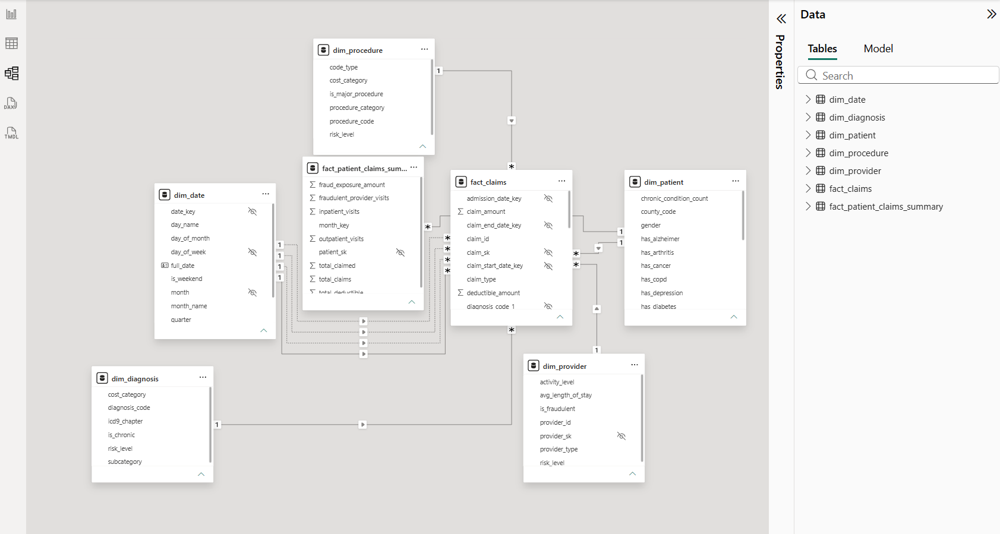
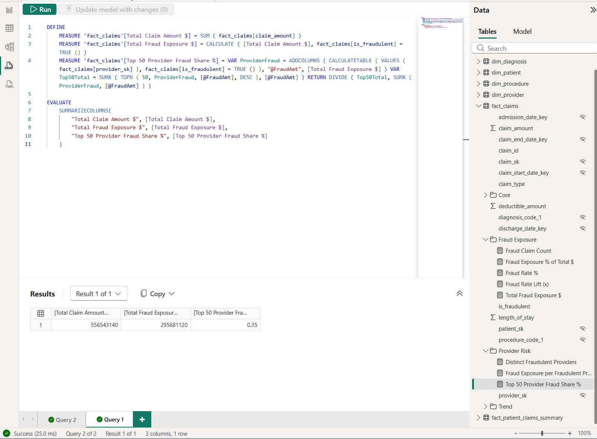

# Medical Insurance Claims Fraud Detection System

    

> **A cloud-native data engineering project demonstrating end-to-end analytics pipeline design for healthcare fraud detection. Built with AWS serverless architecture, dimensional modeling, and a Power BI semantic model with row-level security.**

---

## 📋 Table of Contents
- [Overview](#overview)
- [Key Results](#key-results)
- [Architecture](#architecture)
- [Technologies](#technologies)
- [Getting Started](#getting-started)
- [Project Structure](#project-structure)
- [Documentation](#documentation)
- [Power BI Report & Semantic Model](#power-bi-report--semantic-model)
- [Key Findings](#key-findings)
- [What I Learned](#what-i-learned)

---

## Overview

This project builds a comprehensive fraud detection system for healthcare insurance claims using cloud-native architecture and dimensional modeling. It processes 558,211 claims and identifies fraudulent patterns through:

- **Automated ETL Pipeline**: Lambda-based serverless processing
- **Dimensional Data Warehouse**: Star schema with 3 fact tables & 5 dimensions
- **Advanced Analytics**: OLAP queries for multi-dimensional analysis
- **Power BI Report**: two-page dashboard on a semantic model with 15 DAX measures and row-level security, defined as code (TMDL)

**The Problem**: Payers have far more providers than investigators can review, so the practical question is where to look first and which signals are worth monitoring.

**Our Solution**: An automated dimensional-modeling pipeline that identifies $295.68M in fraud exposure concentrated among a small subset of providers (see [Key Results](#key-results) below).

---

## Key Results

| Metric | Value |
|--------|-------|
| **Claims Processed** | 558,211 (100% of dataset) |
| **Fraud Exposure Identified** | $295.68M (53.1% of all reimbursed dollars) |
| **Claims from Flagged Providers** | 212,796 (38.1% of all claims) |
| **Fraudulent Providers** | 506 of 5,410 providers (9.35%) |
| **Provider Risk Concentration** | Top 50 providers (0.92% of all providers) account for ~35% of total fraud exposure |

*All figures above are computed directly from the star schema — see
[`powerbi/data_prep.py`](./powerbi/data_prep.py) for the reproducible
extract used to verify them.*

### Dashboard Preview


The seven findings, including why flagged providers account for 38% of claims but 53% of dollars, are in [Key Findings](#key-findings). The full report, RLS design, and model-as-code setup are in [Power BI Report & Semantic Model](#power-bi-report--semantic-model).

> **Note:** earlier versions of this README claimed geographic
> concentration ("67% of fraud in 5 states") and a Q4 seasonal spike
> ("+25%"). Both were checked against the underlying data and found to
> be incorrect: patient location is a numeric SSA/CMS code with no name
> mapping (see `docs/data-dictionary.md`), and the monthly fraud rate is
> flat. Both claims were removed rather than corrected with guessed numbers.

---

## Architecture

```
┌─────────────────────────────────────────────────────────┐
│                  HEALTHCARE CLAIMS DATA                 │
│         (Kaggle Dataset: 558K claims, 4 CSV files)      │
└────────────────────────┬────────────────────────────────┘
                         │
                         ▼
            ┌────────────────────────┐
            │    AWS S3 (Raw Data)   │
            │  /raw/claims/          │
            │  /raw/providers/       │
            └────────────┬───────────┘
                         │
         ┌───────────────▼──────────────┐
         │   AWS Lambda (ETL Pipeline)  │
         │  • Data Cleaning             │
         │  • Dimension Key Generation  │
         │  • Fraud Flag Correction     │
         │  • Feature Engineering       │
         │  Execution Time: <5 minutes  │
         └───────────────┬──────────────┘
                         │
         ┌───────────────▼──────────────┐
         │   Amazon Athena (SQL Layer)  │
         │  • View Creation             │
         │  • Transformations           │
         │  • Data Quality Checks       │
         │  • Query Execution           │
         └───────────────┬──────────────┘
                         │
         ┌───────────────▼──────────────┐
         │    Star Schema Data Model    │
         │                              │
         │  FACT TABLES:               │
         │  • fact_claims              │
         │  • fact_provider_summary    │
         │  • fact_patient_summary     │
         │                              │
         │  DIMENSION TABLES:          │
         │  • dim_patient              │
         │  • dim_provider             │
         │  • dim_diagnosis            │
         │  • dim_procedure            │
         │  • dim_date                 │
         └───────────────┬──────────────┘
                         │
      ┌──────────────────┴──────────────────┐
      │                                      │
      ▼                                      ▼
┌──────────────────┐           ┌────────────────────┐
│ Power BI Report  │           │ Analytics Queries  │
│ • Fraud Overview │           │ • Provider Risk    │
│ • Provider Risk  │           │ • Patient Analysis │
│ • RLS by Region  │           │ • Trend Analysis   │
└──────────────────┘           └────────────────────┘
```

**See [ARCHITECTURE.md](./ARCHITECTURE.md) for detailed diagrams and AWS service explanations.**

> **Note on Tableau:** the first version of the dashboards was built in a
> 14-day Tableau Desktop trial that has since expired. The BI layer was
> rebuilt in Power BI; see [Power BI Report & Semantic Model](#power-bi-report--semantic-model).

---

## Technologies

### Cloud Platform
- **AWS S3**: Data lake storage (raw CSV files)
- **AWS Lambda**: Serverless ETL processing (Python 3.9)
- **Amazon Athena**: SQL analytics engine (Presto SQL)
- **AWS Glue Catalog**: Metadata management

### Data Processing
- **Python**: Data transformation, validation
- **Presto SQL**: Query execution, dimension/fact building
- **Pandas**: local re-implementation of the ETL for the Power BI extracts

### Data Warehousing
- **Dimensional Modeling**: Star schema architecture
- **OLAP**: Multi-dimensional analysis capabilities

### Visualization & BI
- **Power BI Desktop**: semantic model, DAX, Power Query (M), row-level security, TMDL model-as-code
- **Tableau Desktop**: original dashboards (trial expired, replaced by Power BI)

### Infrastructure & DevOps
- **Git/GitHub**: Version control
- **CloudWatch**: Monitoring & logging

---

## Getting Started

### Prerequisites
- AWS Account (Free Tier eligible)
- Python 3.9+
- AWS CLI configured
- Power BI Desktop (free, Windows)
- Git

### Quick Start

#### 1. Clone Repository
```bash
git clone https://github.com/ChloeA27/medical-insurance-claims-fraud-detection.git
cd medical-insurance-claims-fraud-detection
```

#### 2. Download Dataset
```bash
# Download from Kaggle
# https://www.kaggle.com/datasets/rohitrox/healthcare-provider-fraud-detection-analysis

# Or use sample data provided
ls data/sample-data/
```

#### 3. Set Up AWS Environment
```bash
# Configure AWS credentials
aws configure

# Create S3 bucket
aws s3 mb s3://your-project-bucket-name

# Upload data
aws s3 cp data/sample-data/ s3://your-project-bucket-name/raw/ --recursive
```

#### 4. Deploy the Lambda Function
```bash
cd lambda/
# Deploy all-in-one-lambda-etl.py (single-file version) or etl_pipeline.py
# + athena_executor.py + config.py to AWS Lambda — see lambda/README.md
```

#### 5. Run ETL Pipeline
```python
# Via AWS Lambda console or CLI
aws lambda invoke \
  --function-name medical-claims-etl \
  --payload '{"step": "all"}' \
  response.json
```

#### 6. Query Results
```sql
-- Run queries directly in Athena against the tables built by sql/01-views,
-- sql/02-dims, sql/03-facts
SELECT * FROM fact_claims_etl LIMIT 10;
SELECT * FROM dim_provider_etl WHERE is_fraudulent = true;
```

#### 7. Build the Power BI Report
```bash
pip install -r powerbi/requirements.txt
python powerbi/data_prep.py          # writes the star-schema CSVs to powerbi/extracts/
python powerbi/tmdl/build_tmdl.py    # regenerates powerbi/tmdl/FraudModel.tmdl
```
Copy the extracts to `C:\fraud-extracts` (or edit the `ExtractsFolder`
parameter), then either:
- **open the finished report:** open `powerbi/pbip/FraudAnalytics.pbip` in
  Power BI Desktop and click **Refresh**, or
- **rebuild the model from scratch:** open a blank report, paste
  `FraudModel.tmdl` into the TMDL view, click **Apply**, then **Refresh**, and
  build the visuals from [`powerbi/DASHBOARD_SPEC.md`](./powerbi/DASHBOARD_SPEC.md).

**See [ARCHITECTURE.md](./ARCHITECTURE.md) for the full pipeline design.**

---

## Project Structure

```
medical-insurance-claims-fraud-detection/
├── README.md                    ← You are here
├── ARCHITECTURE.md              ← System design (as built)
├── PROJECT_PROPOSAL.md          ← Original project-initiation document
├── RESULTS.md                   ← Key findings
│
├── docs/                        ← Documentation
│   ├── data-dictionary.md
│   ├── fraud-patterns.md
│   └── technical-decisions.md
│
├── sql/                         ← Athena SQL, by layer
│   ├── 01-views/                ← Raw → cleaned _etl views
│   ├── 02-dims/                 ← Dimension table CTAS
│   ├── 03-facts/                ← Fact table CTAS
│   └── README.md
│
├── lambda/                      ← Serverless ETL orchestration
│   ├── etl_pipeline.py          ← Lambda handler (step-based orchestration)
│   ├── all-in-one-lambda-etl.py ← Single-file deployable version
│   ├── athena_executor.py       ← Athena query execution helper
│   ├── config.py
│   └── README.md
│
├── data/
│   └── sample-data/             ← Raw Kaggle CSVs
│
└── powerbi/                     ← Power BI semantic model layer
    ├── data_prep.py             ← pandas ETL → star-schema CSV extracts
    ├── pbip/                    ← saved Power BI Project (report + model as text)
    │   └── FraudAnalytics.pbip
    ├── tmdl/
    │   ├── build_tmdl.py        ← model defined as code
    │   └── FraudModel.tmdl      ← paste into TMDL view → full model
    ├── SEMANTIC_MODEL.md
    ├── RLS_DESIGN.md
    ├── DASHBOARD_SPEC.md
    └── screenshots/
```

---

## Documentation

| Document | Purpose |
|----------|---------|
| [ARCHITECTURE.md](./ARCHITECTURE.md) | System design, AWS services, data flow (as built) |
| [PROJECT_PROPOSAL.md](./PROJECT_PROPOSAL.md) | Original project-initiation document (goals & target architecture at kickoff) |
| [Data Dictionary](./docs/data-dictionary.md) | Field definitions, data types, transformations |
| [Fraud Patterns](./docs/fraud-patterns.md) | Detailed fraud findings & insights |
| [Technical Decisions](./docs/technical-decisions.md) | Why specific tools were chosen |
| [SQL Readme](./sql/README.md) | Query documentation & usage |
| [Lambda Readme](./lambda/README.md) | ETL pipeline setup & deployment |

---

## Power BI Report & Semantic Model

The BI layer is a two-page Power BI report on a star-schema semantic model
with 15 DAX measures and row-level security. The whole model is defined as
code and rebuilt from a single TMDL script.

### Page 1: Executive Fraud Overview


Headline KPIs with both denominators (38.1% of claims vs. 53.1% of dollars),
the monthly trend of claims vs. fraud exposure, and exposure by claim type,
provider type, and provider risk tier. Visuals cross-filter each other.

### Page 2: Provider Risk Deep-Dive


A sortable provider risk register, the top 20 providers by fraud exposure, a
claim volume vs. average claim amount scatter for outlier spotting, and fraud
rate lift by diagnosis chapter. Selecting a provider filters the diagnosis
table to that provider's claims.

### Row-level security


Viewing as `Analyst_State05`, every measure recalculates for that region:
51,350 claims, 59.1% fraud rate, and a top-50 concentration of 98.2%. Two
design decisions make this safe:
- **Every visual uses measures from `fact_claims`.** The RLS filter on
  `dim_patient` flows down to the fact table but not back up to
  `dim_provider`, so pre-aggregated provider columns would have shown
  national totals to a regional analyst.
- **`fact_provider_summary` was left out of the model.** It has no path to
  `dim_patient`, so RLS could not filter it and it would have leaked
  national numbers.

### Star schema


Single-direction, many-to-one relationships; a contiguous, marked date table
(`dim_date`) with one active and three inactive date relationships; and ICD-9
code keys typed as text to keep leading zeros and alphanumeric V/E codes.

### DAX


`Top 50 Provider Fraud Share %` builds a per-provider exposure table with
`ADDCOLUMNS`, takes the top 50 with `TOPN`, and divides by the total. Because
it is evaluated in filter context, the same measure returns 35.3% nationally
and 98.2% for a single region.

### Model as code
- [`powerbi/data_prep.py`](./powerbi/data_prep.py) is a pandas
  re-implementation of the `sql/01-views` → `sql/02-dims` → `sql/03-facts`
  logic. It produces the star-schema CSVs locally (no AWS account needed) and
  reproduces the Athena pipeline's 558,211 claims and $295.68M exposure.
- [`powerbi/tmdl/build_tmdl.py`](./powerbi/tmdl/build_tmdl.py) generates
  [`FraudModel.tmdl`](./powerbi/tmdl/FraudModel.tmdl): every table with its
  Power Query (M) import, all relationships, the 15 DAX measures, and the 4
  RLS roles. Pasting it into Power BI Desktop's TMDL view and clicking
  **Apply** builds the full model in one step.
- [`powerbi/pbip/`](./powerbi/pbip/) is the saved Power BI Project: the
  report layout (every page and visual as JSON) and the semantic model (TMDL
  files per table, relationship set, and role), plus the DAX queries used to
  verify the measures. Open `FraudAnalytics.pbip` in Power BI Desktop to see
  the full report.
- Design notes: [`SEMANTIC_MODEL.md`](./powerbi/SEMANTIC_MODEL.md) (tables,
  relationships, every measure with its expected value),
  [`RLS_DESIGN.md`](./powerbi/RLS_DESIGN.md) (roles and test values), and
  [`DASHBOARD_SPEC.md`](./powerbi/DASHBOARD_SPEC.md) (every visual and
  interaction).

---

## Key Findings

A payer's investigators can only review a limited number of providers, so the
practical question this analysis answers is **where to look first, and which
signals are worth monitoring**. Every number below is computed from the
star-schema extracts and matches the Power BI measures.

### 1. A short, ranked review list covers most of the exposure
Fraud exposure is concentrated in a small number of providers:

| Providers reviewed (ranked by exposure) | Share of total fraud exposure |
|---|---:|
| Top 10 | 11.4% |
| Top 50 | 35.3% |
| Top 87 (17% of flagged, 1.6% of all providers) | 50% |
| Top 100 | 54.3% |
| Top 221 (44% of flagged) | 80% |

The single highest-exposure provider accounts for $6.0M. A review queue ranked
by exposure, rather than by claim count or alphabetically, recovers half of
the exposure after fewer than 90 provider reviews.

### 2. The dollar gap comes from case mix, not from inflated prices
Flagged providers file **38.1% of claims but 53.1% of reimbursed dollars**.
Breaking that gap down shows where it comes from:

| | Flagged providers | Other providers |
|---|---:|---:|
| Inpatient share of claims | 11.0% | 4.9% |
| Inpatient share of dollars | 81.6% | 64.0% |
| Avg inpatient claim | $10,311 | $9,783 |
| Avg outpatient claim | $287 | $286 |
| Avg inpatient length of stay | 5.7 days | 5.6 days |
| Avg chronic conditions per patient | 4.5 | 4.5 |

Within each claim type, flagged providers bill almost the same amount per
claim (+5% for inpatient, +0.5% for outpatient) and treat patients with the
same burden of chronic conditions. What differs is that **they bill more than
twice as many of their claims as inpatient stays**. A rule that flags
unusually expensive claims would miss most of this exposure; tracking each
provider's inpatient share against peers is a much stronger signal.

### 3. Fraud *rate* and fraud *dollars* point to different provider types

| Provider type | Providers | Share flagged | Share of fraud exposure |
|---|---:|---:|---:|
| Primarily Hospital | 189 | 45.0% | 27.4% |
| Hospital Only | 398 | 11.1% | 4.2% |
| Primarily Clinic | 1,478 | 20.8% | 60.9% |
| Clinic Only | 3,318 | 2.0% | 7.4% |
| Mixed | 27 | 11.1% | 0.1% |

Mixed hospital/clinic practices are flagged far more often than pure ones.
But by dollars, "Primarily Clinic" providers hold the largest share of
exposure simply because there are many more of them. A rate-based view and a
dollar-based view would send investigators to different places, which is why
the dashboard shows both.

### 4. Larger providers are far more likely to be flagged
Splitting providers into five equal groups by claim volume, the share flagged
rises from **0.7%** in the lowest-volume group to **27.6%** in the highest.
This is a correlation, not proof that size causes fraud: larger providers may
also be audited more often, which would shape how the labels were assigned.

### 5. Diagnosis is a weak signal on its own
By ICD-9 diagnosis chapter, the fraud rate stays within 0.66x to 1.08x of the
baseline (`Fraud Rate Lift (x)` on page 2). The highest chapter, Infectious
and Parasitic Diseases, runs at 41.3% against a 38.1% baseline. Specific
diagnosis/procedure pairs with at least 100 claims reach about 1.6x. Diagnosis
is useful as a secondary filter once a provider is under review, but the
provider is the primary unit of risk.

### 6. Exposure is steady over time
Across the 12 months of 2009, the monthly fraud rate stays between 37.8% and
38.5% by count and between 50.8% and 54.7% by dollars. There is no seasonal
spike, so this is a steady-state problem rather than one that calls for
seasonal review staffing.

### 7. Regional views change priorities, but fraud crosses regions
Among the 32 state codes with at least 5,000 claims, the fraud rate ranges
from **12.3% to 59.1%**. Within each of the four largest state codes, about 20
providers cover 80% of that region's exposure (state code 5: 22 of 175
flagged providers; 10: 20 of 258; 45: 18 of 118; 33: 19 of 123). In state
code 5 the top 50 providers hold **98.2%** of regional exposure, compared with
35.3% nationally.

At the same time, flagged providers bill patients from a median of **4 state
codes**, and only 16.6% stay within one. Regional queues are efficient, but a
national team still needs to own providers that operate across regions. This
is the reasoning behind the RLS design: regional analyst roles plus an
unrestricted `National_Fraud_Team` role.

### Methodology and caveats
- **Labels are provider-level.** The Kaggle dataset flags providers, not
  individual claims. "Fraud exposure" therefore means all reimbursed dollars
  from flagged providers, which is an upper bound on actual fraudulent
  payments.
- **State codes are numeric SSA/CMS codes** with no verified name mapping, so
  regions are reported by code and never plotted on a map.
- **Coverage is about 13 months** (late November 2008 to December 2009); the
  2008 months are partial, so time comparisons use 2009.
- Correlations above are descriptive. They show where to look, not why
  providers commit fraud.

**See [RESULTS.md](./RESULTS.md) for the full methodology and verification queries.**

---

## 📈 Performance Metrics

### Execution Performance
- **Data Volume**: 558,211 claims + 138,556 patients = 696,767 total records
- **Processing Time**: 4 min 47 sec (entire pipeline)
- **Throughput**: 2,420 records/second

### Query Performance
- **Fact Table Query**: <2 seconds (on 558K rows)
- **Aggregation Query**: <3 seconds (with grouping)
- **Join Query**: <5 seconds (across 5 dimensions)

### Cost Efficiency
- **Lambda Invocation**: $0.20 per full pipeline run
- **Athena Queries**: <$1 per run (pay-per-query)
- **S3 Storage**: $2-5/month for all data
- **Total Monthly Cost**: $50-100 (scaling with usage)

---

## What I Learned

### Technical Skills
✅ **Cloud Architecture**: Designed serverless, scalable AWS pipelines
✅ **ETL Engineering**: Built production-grade data pipelines with error handling
✅ **Data Modeling**: Created optimized star schemas for analytics
✅ **SQL Mastery**: Complex queries with CTEs, window functions, aggregations
✅ **Python Development**: pandas re-implementation of the SQL ETL, validated against the Athena output
✅ **BI Engineering**: Power BI semantic modeling, DAX filter context, row-level security, model-as-code with TMDL

### Business Skills
✅ **Domain Knowledge**: Understood healthcare billing, ICD codes, fraud patterns
✅ **Data Analysis**: Discovered actionable fraud insights worth $295M
✅ **Communication**: Translated technical findings into business impact
✅ **Problem Solving**: Handled edge cases (embedded quotes, date formats, nulls)

### Key Technical Insights
1. **Data Quality Matters**: alphanumeric ICD-9 codes with leading zeros, blank diagnosis codes, and mixed date formats decided whether relationships matched (98.1% of claims match a primary diagnosis)
2. **Dimensional Modeling**: Star schema made complex fraud analysis possible
3. **Serverless Benefits**: Lambda + Athena provided cost efficiency vs. traditional warehouse
4. **Denominators Matter**: the same fraud flag reads as 38% or 53% depending on whether you count claims or dollars, so every KPI states which one it uses

---

## 🤝 Contributing

This is a portfolio project, but feedback is welcome!

- Want to extend it? Fork and create a PR!

---

## 📄 License

This project is licensed under the MIT License - see [LICENSE](LICENSE) for details.

---

## 👤 Author

**Qi An**
- GitHub: [@ChloeA27](https://github.com/ChloeA27)
- LinkedIn: [Qi An](https://www.linkedin.com/in/qianchloe/)

### Project Timeline
- Started: Oct 2025
- Completed: Dec 2025

---

## 🙏 Acknowledgments

- **Dataset**: Kaggle Healthcare Provider Fraud Detection
- **Inspiration**: Real-world healthcare fraud challenges
- **Tools**: AWS, Power BI, Tableau (original dashboards), open-source community

---

⭐ If this project helped you, please star it! ⭐

